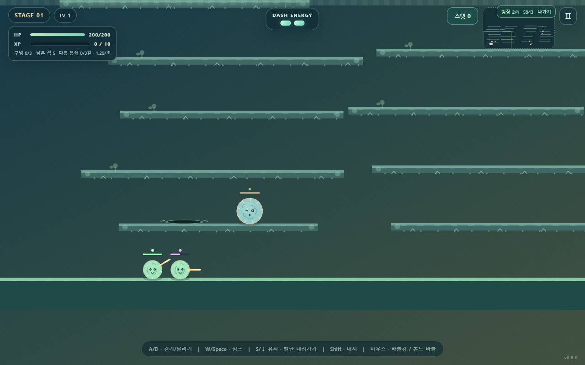

# 털실 대소동 / Yarn Mayhem

통통 뛰는 같은 등급의 털실 적이 합쳐지고 다시 분열하는 횡스크롤 액션 RPG. 바늘 공격으로 적을 처치하고, 맵 곳곳에 잠시 열리는 균열에서 나오는 적의 공세를 막습니다. 스탯 트리를 키워 혼자 또는 최대 4명이 함께 도전합니다.

**[바로 플레이 / Play](https://byh-playground.github.io/yarn-mayhem/)** · **v0.20.2**



Merge-and-split yarn enemies, primary ranged needles and shared charged-dash enemies in a physics action RPG for 1–4 players.
Defend against yarn enemies emerging from map-wide temporary rifts; needles fight enemies and do not close rifts.

## 0.20.2 - Sync high-stage rift emissions

- Derive the guest's per-rift emission receive bound from the existing 3-second lifetime and 30 TPS fixed tick. Stage-14 rifts stay visible after nine ordinary emissions without changing host spawning.
- `npm run test:rift:rtc` checks the 8/9/90/91 receive boundaries, stage-40's actual 71-emission rift, expiry and reconnection with a Microsoft Edge host and landscape-touch guest.

## 0.20.1 - SVG source migration

- Moves yarn bodies, needle variants and effects, rift bodies and pulses, faces, and revive progress into first-party SVG assets. GameKit v0.6.1 drives their expressions and authored clips from gameplay timestamps; physics, network state, and rift scheduling stay unchanged.
- Adjacent face instances batch only when GameKit sees the same mesh, projection, and part pose within the existing face painter layer. Actor telemetry still counts each actor's logical asset draw; unique poses and color/flash state remain separate instances.

- npm run build verifies compiler provenance, recompiles all seven SVG sources, and emits the deployable site into _site.
- npm run test:vector-assets captures current Microsoft Edge 0.20.1 desktop/landscape-touch scenes against fixed-time 0.20.0 scenes with tier-10 yarn, then checks retained geometry and renderer stats.

## 0.19.7 — Sync high-stage rifts in co-op

- Guests now apply every active rift in the host snapshot. The former four-rift receive limit hid later rifts once stage-scaled creation exceeded four.
- The receive limit derives from the existing 3-second lifetime and 30 TPS tick, supporting up to 90 active rifts without changing spawn timing or host ownership.
- `npm run test:rift:rtc` covers six simultaneous stage-40 rifts between an Edge desktop host and a landscape-touch guest.


## 0.19.6 — 단계별 균열 주기와 96마리 상한

- 스테이지가 올라가면 각 균열의 적 출현 간격은 1초 × 0.9^(스테이지−1), 새 균열 간격은 2초 × 0.9^(스테이지−1)로 줄어듭니다. 균열 수명은 3초로 유지합니다.
- 균열별 출현 간격을 전역 4.2회/초 예산으로 늦추지 않습니다. 동시 적 96마리 상한에 닿으면 예정 시각을 균열별 주기로 앞으로 넘겨 누적 출현을 버리고, 자리가 나면 정상 주기로 재개합니다.
- 자동 균열 생성은 한 틱에 하나까지입니다. 출현은 3초 수명과 30 TPS로 제한되는 활성 균열 목록 안에서 전부 처리하며 싱글/호스트 `stepWorld`가 소환을 소유합니다.
- `npm run test:spawn:interval`은 Edge 데스크톱과 844×390 가로 터치에서 스테이지 1/2/3/15/40 간격, 균열 수명, 동시 적 상한과 상한 해제 뒤 재개를 검사합니다.

## 0.19.3 — 배경 균열의 깊이와 적 출현 연출

- 배경 균열을 벽에 난 좁은 세로 틈으로 그리고, 개폐 단계에 맞춰 자연스럽게 조이고 넓힙니다.
- 적이 나오는 순간 벽의 앞쪽 실밥이 잠시 적 아래를 지나도록 해 벽에서 튀어나오는 층위를 보강합니다. 소환 규칙과 멀티플레이 동작은 바꾸지 않습니다.
- PC와 가로형 터치 화면의 Edge 전후 비교는 docs/rift-visual-comparison/에서 확인할 수 있습니다.

## 0.19.2 카메라 시야 안쪽에 열리는 균열

- 기존 균열 지형·생성 간격·수명·티어/출현 판정은 유지하고, 균열 위치만 현재 화면 주변의 유효 후보로 제한합니다. 균열 중심은 화면 가장자리와 터치/HUD 조작부에서 여유를 두고, 생존 플레이어마다 최소 236월드픽셀 떨어져야 합니다. 조건에 맞는 위치가 없으면 그 회차는 건너뜁니다.
- 호스트는 기존 입력 패킷으로 받은 참가자 카메라 시야를 포함해 후보를 한 번 선정하고, 하나의 호스트 프레임으로 모두에게 복제합니다. 후보는 가능한 한 많은 플레이어 화면에 보이도록 점수화하며 물리·스폰 권한은 계속 싱글/호스트 `stepWorld`에 있습니다.
- 방 계약은 `0.19.2/v0192`입니다. `npm run test:rift`는 실제 Edge PC와 가로 터치에서 자동 선택·화면 가시성·플레이어 거리와 균열 수명을 확인하고, `npm run test:rift:rtc`는 참가자 시야 입력·호스트 단일 선정·복제를 확인합니다.

## 0.19.1 배경 공중에도 열리는 균열

- `npm run test:rift` checks the background-rift lifecycle in Microsoft Edge on desktop and landscape touch; `npm run test:rift:rtc` checks seeded host/guest anchor and hole replication over a live two-peer RTC room.

- 공중도 장면의 배경 벽이라는 사용자의 정정에 따라, 균열이 고체 지형에만 붙지 않고 맵 안의 비어 있는 공간에도 생깁니다. 배경 균열은 충돌체가 아닌 시각 기준점이며, 바닥·발판·좌우 경계 균열과 함께 나타납니다.
- 배경 균열은 맵 시드로 만든 위치 목록을 호스트와 참가자가 동일하게 재구성합니다. 월드 경계 밖, 발판 안, 적이 출현하는 순간 플레이어와 겹치는 위치는 후보에서 제외합니다. 시각적으로는 정면 타원 구멍이며 적은 위쪽을 중심으로 튀어나온 뒤 중력으로 떨어집니다.
- 2초마다 새 균열, 균열별 1초 출현 간격, 3초 수명(320ms 열림·300ms 닫힘), 기존 전역 출현 상한과 동시 적 상한 96은 유지합니다. 처치 목표 뒤에도 기존 균열은 자연스럽게 끝납니다.
- 방 계약은 `0.19.1/v0191`입니다. 싱글과 방장은 동일한 `stepWorld`로 시뮬레이션하고, 참가자는 시드와 균열 종류·위치를 포함한 호스트 프레임을 적용합니다.

## 0.19.0 표면을 따라 열리는 균열과 구멍별 출현 (이전)

- 첫 균열은 440ms에 열리기 시작해 기존 첫 적 출현 시각인 760ms에 적을 내보냅니다. 이후에는 2초마다 새 균열이 생기며, 각 균열은 생성 후 3초에 사라집니다.
- 각 균열은 1초마다 적 한 마리를 출현시킬 수 있습니다. 첫 320ms는 열림, 마지막 300ms는 닫힘 연출로 사용합니다. 기존 스테이지별 전역 출현 상한(1.2/초 + 스테이지당 0.25, 최대 4.2/초)과 동시 적 상한 96은 유지하며, 상한이 걸리면 해당 균열의 출현을 늦춥니다.
- 균열은 바닥·발판의 윗면과 좌우 벽의 실제 표면에 붙습니다. 적 몸체를 지형 바깥에 놓고 위쪽을 중심으로 한 90도 방향 범위로 밀어냅니다. 벽에서는 벽을 향한 방향을 제외해 경기장 안쪽과 위를 향하게 합니다.
- 처치 목표에 도달하면 새 균열 생성만 멈춥니다. 이미 열린 균열은 닫히기 전까지 출현을 이어가고 3초 수명을 마친 뒤 제거됩니다. 모든 균열과 남은 적이 정리되면 스테이지가 끝납니다.
- 싱글과 방장은 동일한 stepWorld로 출현을 판정하며, 참가자는 균열 표면·법선·수명·식별자와 적 상태를 호스트 스냅샷으로 받습니다. 당시 방 계약은 0.19.0/v0190이었습니다.

## 0.18.0 맵 곳곳에 나타나는 일시적 균열

- 당시에는 유효한 지형 위치에서 1초마다 새 균열이 나타났고, 3초 뒤 사라졌습니다. 0.19.0부터 생성 간격과 구멍별 출현 간격을 분리했습니다.
- 처치 목표 8명(+스테이지마다 4명), 전역 침공 상한과 동시 적 상한 96은 유지합니다.

## 0.17.0 통통 이동과 열린 소형 맵

- 모든 적의 기본 이동은 실제 착지 → 짧은 눌림 준비 → 수직 속도에 의한 도약 → 중력 비행 → 착지입니다. T1~T10에서 기본 상승 약31~51px, 도약 간격 약0.70~0.87초를 관측했습니다. 비행을 렌더 y축 오프셋으로 만들지 않습니다. 눌림 표시는 고정된 원형 충돌체의 발 위치를 기준으로 한 작은 변형이며 도약 높이·충돌은 실제 Matter 몸체가 소유합니다.
- 경로 점프는 기존 티어별 큰 점프를 사용하고, 목표 몸체 옆의 빈 공간에 착지한 뒤 공격합니다. 기존 충전대시·원거리·피격 넉백·솟아오름·분열 비행·고정/튕김은 기본 도약보다 우선합니다. 일반 공중 접촉은 무피해이며 공격 시간·피해·스폰 속도는 유지합니다.
- 실제 월드는 **3050×1830 → 2280×1590**(폭 약25%, 면적 약35% 감소), 바닥은1650→1410입니다. 5개 맵 유형의 플랫폼은 **30/26/33/27/17 → 6/6/6/6/4개**, 층별 상승 간격은102~126→144~168px입니다. 가지 발판을 제거하고 경로·층 수를 줄여 열린 바닥 통로와 공중 공간을 만듭니다. 카메라 확대를 통한 축소가 아니며 넓은 PC 화면에서는 작은 월드를 가운데 둡니다.
- 유저 기본 지상 속도는 **280→250px/s(−10.7%)**입니다. 이동 투자 배율은 그대로라 최대350px/s입니다. 점프12.8·대시830px/s·가속·제동은 그대로입니다. 바늘29/520ms, 적 추격560~632px/s와 충전300ms→대시220ms→공격100ms→회복220ms→대기140ms도 유지합니다.
- 새 월드·적 이동 스냅샷 계약은 **0.17.0/v0170**입니다. 함께 플레이하는 모든 창을 새로고침하세요. 기존 누적 포인트·투자는 유지합니다. 싱글/방장의 같은 stepWorld가 물리를 실행하고 게스트는 확정 이동 상태를 받습니다.
- npm run test:hopping은 모든 티어·실제 지형/경계·도약 중 상태 전환·맵 유형·성능을 확인합니다. npm test는 실제2인 상태 일치·투자·입력 취소, npm run test:combat은 바늘/충전대시의 고정 전투 흐름입니다. 실제 Edge PC·가로 모바일 검증과 미검증 범위는 [검증 기록](docs/verification.md)에 있습니다.

## 0.16.2 모바일 화면과 스크롤

- 가로 메인·모드 선택·멀티 메뉴를 짧은 카드로 구성합니다. 방 생성 후에는 코드·복사·나가기와 시작 동작에 집중하며, 다른 메뉴는 뒤로 돌아가 선택합니다.
- 도움말은 **목표·이동·전투·성장** 탭으로 나눕니다. 모바일 가로 스탯은 **기술 목록 → 효과·조건·투자 상세 → 목록** 순서로 사용하며, 닫기와 투자 버튼은 화면 안에 유지합니다. PC의 두 영역 트리는 그대로입니다.
- 일시정지·클리어·종료 팝업은 결과와 다음 동작을 보여 줍니다. 반복 조작 설명은 도움말에서 확인합니다. 이동 패드 안내도 조작 영역 안에 배치했습니다.
- 동적 화면 높이와 safe-area 여백을 반영하고 주소창 높이 감소 시 즉시 dvh 상한을 적용합니다. 스탯을 연 채 세로로 돌려도 회전 안내 버튼을 사용할 수 있습니다. 필요한 본문을 잘라 숨기는 방식으로 스크롤을 없애지 않습니다.
- Windows Edge의 고정 모바일 흐름은 npm run test:mobile입니다. 844×390·667×320·568×280 및 740×320 안전영역 모사에서 메뉴·모든 도움말/기술·방장 상태·터치·팝업·높이 변화를 검사합니다. 실제 기기의 노치·주소창·키보드는 별도 확인이 필요합니다.
- 이 버전은 UI 호환 패치입니다. 저장·전투·0.16.0/v0160 방 계약은 유지합니다.
- 이전 검술 투자 전환 안내는 메인에만 표시하며, 568×280 첫 실행에서도 시작·스탯·도움말이 모두 화면 안에 들어옵니다. 안내가 다른 메뉴와 결과 팝업에 따라붙지 않습니다. 모바일 고정 흐름 203개와 기존 실제 2인 경험 흐름 21개를 확인했습니다.

## 0.16.0 바늘 성장·모바일 가로·빠른 적 진입

- 기본 바늘 피해는 **29**, 발사 주기는 **520ms**입니다. 단일 대상 기본 이론 연사량은 55.8 피해/초이며, 최대 세 대상에 실제 명중하면 각 대상에 같은 피해를 줍니다. 피해가 들어가는 시점은 실제 접촉입니다. 남은 HP가 적으면 표시 피해는 그 HP까지만 계산합니다.
- 튕겨꿰기는 같은 바늘이 실제로 이동하며 서로 다른 적을 최대 3체까지 맞힙니다. 명중 뒤 70ms 대기와 근거리 다음 비행의 90ms 목표 시간을 두어 순서가 읽히게 했습니다. 거리·대상 이동·수명에 따라 도중에 끝날 수 있습니다. 대비 있는 궤적, 명중 지점의 십자광·파편·연쇄 번호, 높아지는 충격음이 확정 명중에 연결됩니다. 궤적은 450ms 뒤 사라집니다.
- Bounko의 실제 명중 지점 중심 링·파편·충격음과 제한된 흔들림을 참고했습니다. 이번 바늘 명중의 흔들림은 최대 0.8 월드 픽셀이며 표적 부위 피드백을 중심으로 구성합니다. 시각 효과 난수는 게임 판정 난수와 분리합니다.
- 유저와 적은 유한 관성의 실제 Matter 원형 몸체로 구릅니다. 지면 모터는 선속도와 접지점의 회전 속도를 맞추고, 실제 접촉 마찰·관성과 공중 각운동은 Matter가 계산합니다. 실·섬유의 회전은 몸체의 누적 각도를 사용하며, 게스트도 확정 각도를 보간합니다. 플레이어 반지름은 18px입니다. 이동·점프·플랫폼 통과·바늘 지형 고정은 같은 물리 경로를 사용합니다.
- 적의 추격 설정은 T1–T10 **560–632px/s**로, 유저 기본 280·최대 이동 투자 392px/s보다 빠릅니다. 실제 Matter 지상 측정에서 최대 투자 유저 390.4px/s, T1 추격 486.6px/s였습니다. 720px 안에서는 접근을 우선하고, 몸체 반지름 합 +30px 안에서 300ms 충전 예고 → 220ms 대시 → 100ms 공격 → 220ms 회복 → 140ms 대기를 거칩니다. 적 대시 설정은 1120px/s이며 실제 무충돌 관측 최고 1097.6px/s입니다. 접촉 충격과 마찰로 실제 속도는 달라집니다. 단순 접촉·충전·회복은 무피해입니다. 멀리 있는 같은 티어의 합체와 저체력 합체 판단, T6 이상 원거리 공격을 유지하며 충전·대시·공격 중에는 합체하지 않습니다.
- 솔로·호스트의 공통 stepWorld와 게스트 확정 스냅샷 구조를 유지합니다. 검술 입력·상태를 제거하고 바늘 기술 ID와 플레이어 프레임을 정리하여 방 계약은 **0.16.0/v0160**입니다. 함께 플레이하는 창은 모두 새로고침하세요. 기존 획득 포인트와 다른 투자 저장은 유지됩니다.
- 고정 전투 흐름은 npm run test:combat, 실제 두 피어 RTC·저장 흐름은 npm test입니다. 전후 측정과 미검증 범위는 [검증 기록](docs/verification.md)에 있습니다.

## 조작

- A/D·방향키 이동, W/Space 점프, S/↓ 유지로 발판 내려가기, Shift 대시.
- PC 클릭과 모바일 바늘 버튼은 즉시 바늘을 발사하고, 유지하면 연사합니다. T/스탯 버튼은 기술 트리입니다.
- 모바일은 가로 화면에서 이동 패드와 점프·대시·바늘 버튼을 사용합니다. 세로에서는 회전 안내를 표시합니다. 안내 버튼을 누르면 지원 환경에서 전체 화면과 가로 잠금을 요청하고, 지원하지 않으면 직접 회전하도록 안내합니다. 실제 문서를 90도 회전시키지 않습니다. 회전·화면 크기 변경·포커스 상실·터치 취소는 누르고 있던 입력을 해제합니다. 세로 전환 시 싱글은 일시정지하며, 멀티는 다른 플레이어와 월드를 계속 진행합니다.
- 시작 → 싱글 플레이로 바로 시작하거나, 시작 → 멀티 플레이에서 방을 만들고 4자리 코드를 공유합니다. 방장이 물리와 판정을 실행하고 참가자는 입력을 보내며 확정 상태를 받습니다. 30TPS입니다.

## 메뉴와 스탯 트리

- 메인은 시작·스탯 트리·플레이 방법만 표시합니다. 뒤로 / Esc로 한 단계 돌아가며, 모드 선택만으로 새 게임이 시작되지 않습니다.
- 바늘·제어·기동·생존 버튼으로 계열을 바로 바꿉니다. 노드는 잠겨 있어도 선택해 효과와 선행 조건을 확인할 수 있으며, 별도의 **투자하기** 버튼으로 포인트를 사용합니다.
- 화살표는 선행 관계, 금색 선택 테두리는 현재 조회, 문구는 잠김·포인트 부족·투자 가능·완료를 표시합니다. 트리 상단의 포인트·닫기와 상세 하단의 투자 버튼은 별도 영역입니다.
- `#/start`, `#/multiplayer`, `#/help`, `#/tech/needleEcho`로 메뉴/선택을 복원합니다. URL 진입은 구매나 게임 시작을 실행하지 않습니다.

## 바늘 · 제어 트리

각 노드는 1점으로 한 번 해금합니다. 다음 노드는 바로 앞 노드를 요구합니다. 기동·생존 트리는 기존 효과를 유지합니다.

- 바늘: **굵은 바늘**은 실제 바늘 피해를 30% 올립니다(29→37.7). **가벼운 실감개**는 발사 간격을 15% 줄입니다(520→442ms). **풀림 메아리**는 바늘 처치로 실제 분열한 두 조각에 300ms 뒤 해당 바늘 피해의 25%를 한 번씩 줍니다(강화 시 각 9.425). 메아리는 다시 메아리를 만들지 않습니다.
- 제어: **밀어꿰기**는 바늘 피해 후 첫 생존 적에게 피격 방향으로 한 번 임펄스를 줍니다. 중력과 마찰을 받으며 날아가고, 3초 안에 실제 벽·바닥·발판 표면을 향한 충돌 직전 속도가 300px/s 이상이면 1.2초 고정합니다. 느린 충돌과 스침은 일반 물리 충돌입니다. 일반 상향 점프는 발판을 통과합니다. 밀어꿰기로 날아가는 적은 발판 아래에 법선 속도 300px/s 이상으로 충돌해도 고정됩니다. **튕겨꿰기**는 그 적의 날아감과 별개로 바늘이 420px 안의 서로 다른 적을 최대 3체까지 실제로 튕깁니다. 접촉할 때만 피해를 주며, 첫 적이 죽었으면 다음 생존 접촉 적이 임펄스를 받습니다. 이동 중 대상이 사라지면 살아 있는 대상이나 합체 후속 개체를 다시 찾고, 아무도 없으면 바늘이 사라집니다. **회수절단**은 고정된 적에 바늘 재명중 시 지형 바깥쪽 법선 방향으로 튕겨 첫 다른 적에게 그 바늘 피해의 50% 충돌 피해를 한 번 줍니다. 바늘에 죽으면 기존 분열이 발생합니다.
- 날아감·고정 중에는 AI 공격·합체가 멈추지만 피해는 계속 받습니다. 재명중으로 지속시간은 늘어나지 않습니다. 해제 뒤 0.8초 동안 재고정을 막습니다. 분열 조각에는 고정이 상속되지 않습니다.
- 튕긴 지점에서 날카롭게 꺾인 잔상, 바늘 끝 섬광, 실 파편과 단계별로 올라가는 타격음, 긴 실 꼬리, 꽂힌 바늘 떨림, 벽 충돌 압축·파편·타격음과 거리 감쇠 흔들림, 해제 후 풀리는 실을 사용합니다. 시각 변형은 물리 몸체를 바꾸지 않습니다. 고정된 바늘은 몹 뒤의 축·바늘귀, 몸에 가려지는 관통 부분, 몹 앞에서 지형 접촉점으로 이어지는 축으로 나누어 그립니다. 고정 시 다른 몸체/지형을 침범하지 않는 범위에서 최대 18px만 띄워 앞축을 보여 줍니다.

외곽 충돌 벽은 실제 위치에 그리며 경계에서 카메라가 벽 면을 조금 보여 줍니다. 바늘 고정의 관통 표현·고정 간격과 기존 제어 판정은 유지합니다.

## 성장 저장과 함께 플레이

- 획득한 스탯 포인트와 투자한 기술은 이 브라우저에 자동 저장합니다. 시작·재시작·새로고침·방 만들기·참가·나가기로 지워지지 않습니다. 새 게임은 스테이지/경험치/전투 상태를 새로 시작하고 체력·대시는 회복합니다. 누적 획득점과 이미 투자한 기술은 유지합니다.
- 이전 검술 투자 3종은 저장을 처음 읽을 때 순서대로 바늘 피해·연사·메아리 기술로 전환하고 안내합니다. 이미 쓴 점수·누적 획득점·기동·생존·제어 투자를 보존하며, 변환 결과를 같은 저장 키에 기록합니다. 전투와 통신은 현행 바늘 기술만 사용합니다.
- 저장은 누적 획득점과 기술별 투자 단계만 포함합니다. 남은 점수와 능력치는 기술 정의에서 다시 계산합니다. 체력, 현재 월드와 다른 사람의 성장은 저장하지 않습니다. 브라우저 데이터 삭제·다른 브라우저/기기는 별도이며, 저장이 차단되면 스탯 창에서 알립니다.
- 싱글과 멀티 방장은 같은 `stepWorld`와 투자 액션을 사용합니다. 입력만 로컬/RTC에서 수집합니다. 참가자는 입력과 투자 요청을 보내고 호스트의 확정 결과를 표시합니다. 참가 전 자신의 투자는 입장 데이터로 전달하고, 호스트가 기술·최대 단계·선행 조건·포인트 비용을 검증한 뒤 적용합니다. 원격이 보낸 최종 능력치를 그대로 적용하지 않습니다.
- 같은 0.19.1 클라이언트끼리 접속합니다. 함께 플레이하는 사람 모두 새로고침하세요.

0.16.0은 실제 Edge 155에서 저장 전환·구매·새 게임·새로고침, 모바일 가로 조작과 세로 안내, 실제 2인 RTC의 소유 피해와 회전/터치 취소를 확인했습니다. 경험 흐름 21개와 전투 흐름 20개가 통과했습니다. 실제 모바일 기기·OS 회전 잠금 성공 여부·음질·4인 장시간 플레이는 미검증입니다. [상세 검증 기록](docs/verification.md)을 참고하세요.

## 실행과 검증

`index.html` 하나가 현행 소스이자 배포 게임입니다. 인터넷 연결이 필요하며 Matter.js와 GameKit을 고정 CDN 주소에서 로드합니다.

```sh
npm run dev
# http://127.0.0.1:8000
npm ci
npm test
```

고정 브라우저 시나리오는 Windows에 설치된 Edge를 사용합니다(`chromium.launch({channel:"msedge",headless:true})`). 각 실행 상한은 180초이며 실제 Nostr/RTC 연결을 포함합니다. `npm test`는 저장·가로 입력·실제 2피어 흐름, `npm run test:combat`은 실제 Matter 전투 흐름을 검사합니다. 산출물은 `test-results/`에 보관합니다.

이전 버전의 검증·환경 제한 기록은 [검증 이력](docs/verification.md)에 보관합니다.

PR CI는 문법과 배포 산출물을 검사합니다. 실제 RTC 검증은 로컬 E2E이며 CI 성공만으로 대신하지 않습니다. main 병합 뒤 Actions Pages가 동일 HTML과 [빌드 정보](https://byh-playground.github.io/yarn-mayhem/build.json)를 배포합니다.

## 출처와 변경

- 원본 파일: `YARNFALL_0.8.3.html`.
- 원본 SHA-256: `2f1ae7673df01d9e43803147f6d0e4f2cf6f8c3a4eba385726287ccc6f8e57bf`.
- 최초 원문: Git 커밋 `aa6bd458523378ee69bd5d4ecfa9b51f1dbaa39a`의 `source/original.html`. 현행 실행 복사본은 중복 보관하지 않습니다.
- GameKit v0.3.1: `72b09b260edf9650353017acb49c06873fe9f5a1`. rendering, input, simloop, audio, transport, interpolation을 사용합니다.
- 0.9.1은 SDK 0.3.1의 호환 패치입니다. 기존 `bloom-yarn-mayhem-v090` 방과 welcome `0.9.0` 계약을 유지하며 게임 규칙과 30TPS는 변경하지 않습니다. 배포 모듈 해시는 [고정 명세](docs/gamekit-manifest.json)에 기록합니다.
- 최초 0.9.0 마이그레이션은 새 SDK의 연결 계약 및 방 namespace를 분리하므로 관리 규칙에 따라 **0.8.3 → 0.9.0**입니다. 이전 버전과 같은 방에 접속하지 않습니다.
- 실제 입력을 SDK loop에 전달하고 솔로/방장의 공통 `stepWorld`를 유지했습니다. 표시 위치는 `PresentationRuntime`이 소유하며 Matter 몸체에 되쓰지 않습니다. 대시 상태를 플레이어 아래에 모으고 미사용 풀·타이머·카운터를 제거했습니다.
- 클라이언트는 권위 상태를 보간합니다. 로컬 충돌/공격 예측이나 rollback 게임으로 재설계하지 않았습니다. 기존 단발 효과 ID 중복 억제와 월드 초기화 수명을 유지합니다.

새 라이선스를 부여하지 않습니다. 의존성 및 고지는 [THIRD_PARTY_NOTICES.md](THIRD_PARTY_NOTICES.md)를 참고하세요. [개발](https://github.com/byh-playground/bloom-reference/blob/main/rules/development.html) · [관리](https://github.com/byh-playground/bloom-reference/blob/main/rules/project-management.html) · [UI/UX](https://github.com/byh-playground/bloom-reference/blob/main/rules/visual-ux.html) 규칙을 따릅니다.
